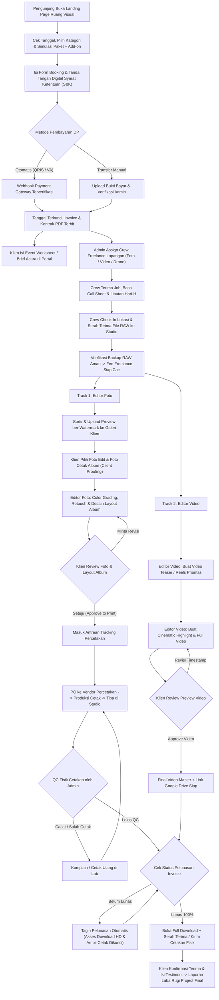
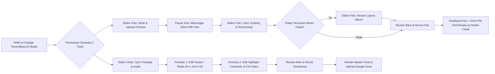
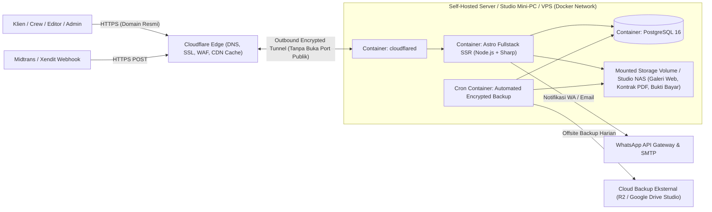
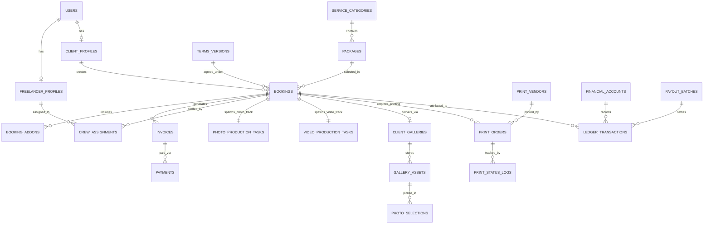

# Product Requirements Document (PRD): Ruang Visual

| Informasi Dokumen | Detail |
| :--- | :--- |
| **Nama Produk** | **Ruang Visual** — Integrated Photography, Videography & Print Management Platform |
| **Versi Dokumen** | 1.0.0 |
| **Tanggal Pembuatan** | 25 Oktober 2026 |
| **Model Aplikasi** | Single-Vendor Cloud Web App (Arsitektur Modular bergaya SaaS khusus operasional brand **Ruang Visual**, siap dikembangkan ke Multi-Tenant di masa depan) |
| **Lini Layanan Utama** | Dokumentasi **Wedding**, **Prewedding**, **Wisuda (Graduation)**, dan **Event** |
| **Tech Stack Utama** | Astro Fullstack (SSR) + PostgreSQL + Tailwind CSS + Self-Hosted via Cloudflare Tunnel (`cloudflared`) |
| **Status** | Ready for Design & Development |

---

## Daftar Isi

1. [Ringkasan Eksekutif & Visi Produk](#1-ringkasan-eksekutif--visi-produk)
2. [Permasalahan Bisnis & Tujuan Produk](#2-permasalahan-bisnis--tujuan-produk)
3. [Aktor, Persona & Hak Akses (RBAC)](#3-aktor-persona--hak-akses-rbac)
4. [Arsitektur Alur Bisnis End-to-End](#4-arsitektur-alur-bisnis-end-to-end)
5. [Kebutuhan Fungsional Detail per Modul](#5-kebutuhan-fungsional-detail-per-modul)
   - [5.1 Modul Landing Page & Katalog Publik](#51-modul-landing-page--katalog-publik)
   - [5.2 Modul Client Booking, Kontrak Digital & Syarat Ketentuan (S&K)](#52-modul-client-booking-kontrak-digital--syarat-ketentuan-sk)
   - [5.3 Modul Pembayaran Hybrid (Payment Gateway & Manual Transfer)](#53-modul-pembayaran-hybrid-payment-gateway--manual-transfer)
   - [5.4 Modul Portal Klien, Galeri Interaktif (Proofing) & Live Tracker](#54-modul-portal-klien-galeri-interaktif-proofing--live-tracker)
   - [5.5 Modul Manajemen Crew Freelance Lapangan](#55-modul-manajemen-crew-freelance-lapangan)
   - [5.6 Modul Produksi & Antrean Kerja Editor (1 Editor Foto & 1 Editor Video)](#56-modul-produksi--antrean-kerja-editor-1-editor-foto--1-editor-video)
   - [5.7 Modul Tracking Percetakan & Pengiriman Fisik](#57-modul-tracking-percetakan--pengiriman-fisik)
   - [5.8 Modul Keuangan Lengkap & Akuntansi Project](#58-modul-keuangan-lengkap--akuntansi-project)
   - [5.9 Modul Panel Admin Lengkap (Backoffice Command Center)](#59-modul-panel-admin-lengkap-backoffice-command-center)
   - [5.10 Modul Notifikasi Otomatis (WhatsApp & Email)](#510-modul-notifikasi-otomatis-whatsapp--email)
6. [Spesifikasi Teknis & Arsitektur Sistem](#6-spesifikasi-teknis--arsitektur-sistem)
7. [Desain Skema Database (PostgreSQL)](#7-desain-skema-database-postgresql)
8. [Struktur Sitemap & Routing Aplikasi](#8-struktur-sitemap--routing-aplikasi)
9. [Kebutuhan Non-Fungsional & Keamanan](#9-kebutuhan-non-fungsional--keamanan)
10. [KPI Keberhasilan & Roadmap Pengembangan](#10-kpi-keberhasilan--roadmap-pengembangan)

---

## 1. Ringkasan Eksekutif & Visi Produk

**Ruang Visual** adalah platform aplikasi web terintegrasi yang mengelola seluruh siklus bisnis vendor dokumentasi foto dan video profesional untuk kategori **Wedding**, **Prewedding**, **Wisuda**, dan **Event** (Lamaran/Engagement, Corporate Gathering, Ulang Tahun, Seminar, dan acara keluarga).

Aplikasi ini menyatukan **etalase pemasaran publik** (Landing Page, Portofolio, Cek Jadwal, Simulasi Paket) dengan **mesin operasional internal** yang dirancang khusus untuk model bisnis *lean studio*:
- **Tim lapangan berbasis sistem Freelance** (Fotografer, Videografer, Drone Pilot, Asisten/Stylist) yang fleksibel mengikuti volume jadwal harian.
- **Tim pascaproduksi terfokus** yang terdiri dari **1 orang Editor Foto** dan **1 orang Editor Video** dengan manajemen kapasitas kerja (*workload queue*) yang terukur.
- **Sistem Galeri Klien Interaktif (*Client Proofing*)** terintegrasi link Google Drive untuk pemilihan foto edit/cetak tanpa rekap manual lewat chat.
- **Sistem Tracking Percetakan** dari persetujuan layout album hingga kendali mutu (*Quality Control*) fisik dan pengiriman ke klien.
- **Sistem Keuangan Lengkap** yang menghitung arus kas, piutang DP/pelunasan, pembayaran fee freelance, gaji/insentif editor, HPP percetakan, hingga laba bersih riil per project (*Per-Project Profitability*).

---

## 2. Permasalahan Bisnis & Tujuan Produk

### 2.1 Permasalahan Operasional Vendor Konvensional
1. **Booking & Jadwal Bentrok**: Pencatatan manual di chat/spreadsheet rawan menyebabkan *double booking*, lupa menagih pelunasan H-7, atau kesalahpahaman terkait Syarat & Ketentuan (revisi, pembatalan, masa simpan file).
2. **Koordinasi Crew Freelance Tidak Terstandar**: Sulit melacak ketersediaan crew di musim ramai (tanggal cantik pernikahan / musim wisuda kampus), brief acara tercecer, dan pembayaran fee kadang cair sebelum file RAW dipastikan aman di-backup studio.
3. **Bottleneck pada 1 Editor Foto & 1 Editor Video**: Tanpa antrean prioritas yang memisahkan track foto dan video (serta jeda otomatis saat menunggu klien memilih foto), beban kerja editor menumpuk dan SLA pengerjaan terlewat.
4. **Seleksi Foto Klien (*Proofing*) Berantakan**: Klien mengirim daftar kode nama file foto via WhatsApp dengan format berbeda-beda sehingga rawan salah edit atau salah masuk album cetak.
5. **Tracking Percetakan Tercecer**: Sering terjadi miskomunikasi status album/frame di vendor percetakan (apakah masih layout, sedang naik cetak, gagal QC warna/grafir nama, atau sudah jadi di studio tapi belum diambil klien).
6. **Keuangan Semu (*Cashflow Illusion*)**: Uang DP pernikahan yang baru akan digelar 5 bulan lagi bercampur dengan laba bulan berjalan, sehingga margin keuntungan bersih per project tidak terlihat jelas setelah dipotong fee freelance dan HPP cetak.

### 2.2 Tujuan Produk (Product Goals)
- **Otomatisasi Konversi Klien**: Memungkinkan calon klien mengecek ketersediaan tanggal, memilih paket + *add-on*, menyetujui S&K secara digital, dan membayar DP 24/7.
- **Transparansi Pengerjaan**: Menghadirkan *Live Progress Tracker* ala pelacakan paket bagi klien guna menekan pertanyaan berulang (*"Kak, foto saya sudah sampai mana?"*) hingga >70%.
- **Kendali Kapasitas Produksi**: Memisahkan alur kerja **Editor Foto** dan **Editor Video** secara paralel dengan SLA yang jelas dan indikator beban antrean real-time.
- **Zero-Error pada Percetakan**: Mewajibkan persetujuan desain layout oleh klien di sistem sebelum status bisa naik ke vendor cetak, disertai pelacakan HPP dan QC fisik.
- **Akurasi Keuangan 100%**: Menyajikan laporan Laba Rugi per Project, manajemen *Unearned Revenue* (dana DP mengendap), rekap payroll crew/editor, dan pelacakan piutang otomatis.

---

## 3. Aktor, Persona & Hak Akses (RBAC)

Sistem menerapkan autentikasi berbasis sesi dan otorisasi **Role-Based Access Control (RBAC)** dengan matriks peran berikut:

| Role | Deskripsi Aktor | Ruang Lingkup Akses Utama |
| :--- | :--- | :--- |
| **Super Admin (Owner)** | Pemilik brand Ruang Visual | Akses penuh ke seluruh fitur: Dashboard Eksekutif, Keuangan Lengkap & Laporan Laba Rugi, Pengaturan Paket/Harga, S&K, Penugasan Crew, Antrean Editor, Tracking Cetak, CMS, dan Audit Log. |
| **Admin Operasional / CS** | Staf admin harian (opsional) | Mengelola Leads/CRM, verifikasi booking & bukti transfer manual, jadwal *technical meeting*, penugasan crew freelance, update status percetakan & pengiriman. *(Akses ke laba bersih total studio dapat disembunyikan melalui permission toggle)*. |
| **Freelance Crew** | Fotografer, Videografer, Drone Pilot, Asisten Lapangan | Portal khusus Crew: Menerima/menolak tawaran job, mengisi kalender ketersediaan, membaca *Call Sheet / Brief Acara*, melakukan *Check-In* kehadiran Hari-H, melaporkan serah terima file RAW, serta memantau histori & pencairan fee. |
| **Editor Foto** | 1 orang spesialis editing foto & desain layout album | Workspace khusus Editor Foto: Verifikasi penerimaan RAW foto, unggah foto *preview* ke Galeri Klien, menerima list pilihan klien, unggah hasil retouch/color grading & draft layout album, menangani revisi foto, dan serah terima file siap cetak. |
| **Editor Video** | 1 orang spesialis editing video (Teaser, Highlight, Full) | Workspace khusus Editor Video: Verifikasi penerimaan footage & audio, antrean prioritas *Teaser/Reels*, unggah link preview video *Cinematic/Full*, menangani revisi berpenanda waktu (*timestamp*), dan finalisasi master video. |
| **Klien (Customer)** | Calon pengantin, wisudawan, panitia event, pasangan | Portal Klien: Booking online, tanda tangan S&K digital, pembayaran DP/termin/pelunasan, pengisian *Event Brief/Worksheet*, pelacakan progres pengerjaan, pemilihan foto di Galeri Interaktif, pengajuan revisi, persetujuan desain album, dan unduh hasil akhir. |
| **Pengunjung Publik / Tamu** | Calon klien & tamu undangan acara | Melihat Landing Page, Portofolio, Pricelist, Cek Tanggal, serta membuka Galeri Publik Acara (jika diizinkan klien) tanpa akses ke fitur seleksi cetak maupun file master privat. |

---

## 4. Arsitektur Alur Bisnis End-to-End



---

## 5. Kebutuhan Fungsional Detail per Modul

### 5.1 Modul Landing Page & Katalog Publik
1. **Hero Showcase**:
   - Menampilkan visual sinematik resolusi tinggi atau pemutar *background showreel* ringan dengan pesan brand **Ruang Visual**.
   - Tombol CTA utama: **"Cek Ketersediaan Tanggal"** dan **"Eksplor Paket Layanan"**.
2. **Navigasi & Halaman Kategori Layanan**:
   - Empat pilar utama dengan halaman kurasi masing-masing:
     1. **Wedding** (Akad, Resepsi, Intimate Wedding, Adat/Tradisional, Ngunduh Mantu).
     2. **Prewedding** (Studio Indoor, Outdoor Alam/Urban, Conceptual, Destination).
     3. **Wisuda (Graduation)** (Personal, Couple, Group/Sahabat, Paket Keluarga Kampus/Studio).
     4. **Event** (Engagement/Lamaran, Siraman/Pengajian, Corporate Event, Seminar, Ulang Tahun, Dokumentasi Konser/Komunitas).
3. **Katalog Paket & Kalkulator Simulasi Harga (*Interactive Package Customizer*)**:
   - Menampilkan detail setiap paket: Durasi kerja (jam/sesi), jumlah crew yang bertugas, jumlah foto edit, jenis output video (Reels/Teaser, Highlight, Dokumentasi Penuh), serta item cetakan fisik (Album, Frame, Box, Flashdisk).
   - Calon klien dapat mencentang **Add-ons** secara interaktif (misal: *Tambah Jam Liputan*, *Drone Aerial*, *Same Day Edit / Express*, *Extra Fotografer*, *Tambahan Album Orang Tua*, *Zona Luar Kota*) dan melihat estimasi total harga beserta nominal minimal DP secara instan.
4. **Public Availability Checker (Cek Tanggal Real-Time)**:
   - Widget kalender publik yang memeriksa kapasitas slot harian Ruang Visual tanpa menampilkan nama klien lain demi privasi.
   - Indikator status tanggal:
     - `Available` (Hijau): Slot terbuka penuh.
     - `Limited Slot` (Kuning): Tersisa 1 slot tim di tanggal tersebut (memanfaatkan keunggulan sistem crew freelance selama kuota kapasitas harian studio & editor masih aman).
     - `Fully Booked` (Merah): Kuota liputan harian studio penuh.
5. **Portofolio & Journal Cerita Klien**:
   - Galeri publik masonry/grid cepat dengan filter kategori (*Wedding*, *Prewedding*, *Wisuda*, *Event*) dan tema warna/lokasi (*Indoor*, *Outdoor*, *Traditional*, *Modern*).
   - Halaman *Story/Album Publik* per project (hanya untuk project yang kliennya memberi izin publikasi portofolio pada kontrak S&K).
6. **Halaman Publik Tambahan**:
   - Halaman **Syarat & Ketentuan Umum**, **Alur Pemesanan & Pengerjaan**, **FAQ**, **Testimoni Terverifikasi**, serta tombol **Konsultasi WhatsApp** yang otomatis merekam sumber *lead* sebelum mengarahkan ke chat Admin.

---

### 5.2 Modul Client Booking, Kontrak Digital & Syarat Ketentuan (S&K)
1. **Multi-Step Booking Wizard**:
   - **Langkah 1 — Layanan & Paket**: Pilih kategori, paket dasar, dan *add-on* opsional.
   - **Langkah 2 — Waktu & Lokasi**: Pilih tanggal acara, jam mulai–selesai (khusus Wisuda mendukung pemilihan sesi jam per slot, misal `07.00–09.00` atau `13.00–15.00`), nama venue/kampus/gedung, kota/kabupaten (otomatis menghitung biaya transport zona luar kota jika di luar area bebas transport), dan titik koordinat Google Maps.
   - **Langkah 3 — Identitas Klien**: Nama lengkap pemesan, nama pasangan/wisudawan/instansi, email aktif, nomor WhatsApp utama & cadangan, serta akun Instagram.
   - **Langkah 4 — Kode Promo / Voucher**: Validasi kupon diskon (misal promo *Wedding Fair* atau *Early Bird Wisuda*).
   - **Langkah 5 — Persetujuan Syarat & Ketentuan (S&K) & Tanda Tangan Digital**.
2. **Sistem Manajemen Syarat & Ketentuan (S&K) Berversi (*Versioned T&C*)**:
   - Admin dapat mengatur template klausul S&K berbeda untuk kategori *Wedding/Prewedding*, *Wisuda*, dan *Event*.
   - Klausul wajib yang diatur secara eksplisit di dalam sistem:
     1. **Ketentuan Booking Fee (DP)**: Persentase atau nominal minimal pengunci tanggal dan sifat *non-refundable* apabila pembatalan sepihak dari klien.
     2. **Jadwal Pelunasan**: Batas maksimal pelunasan (misal H-7 untuk Wedding/Event, atau H-1 / sebelum serah terima file untuk Wisuda) serta konsekuensi penahanan pengiriman file resolusi penuh/cetakan apabila belum lunas.
     3. **Kebijakan Perubahan Jadwal (*Reschedule*)**: Batas waktu pemberitahuan minimal (misal H-14 untuk Wedding, H-3 untuk Wisuda jika jadwal universitas berubah), maksimal frekuensi reschedule, dan penyesuaian dengan ketersediaan slot.
     4. **Overtime & Akomodasi Lapangan**: Tarif biaya kelebihan jam di lokasi acara, biaya tiket masuk lokasi pemotretan (*location permit/charge*), serta ketentuan konsumsi/penginapan crew untuk liputan durasi panjang atau luar kota.
     5. **Estimasi Waktu Pengerjaan (SLA)**: Target hari kerja untuk Preview Foto, Teaser Video, Hasil Edit Foto & Video Utama, serta produksi Percetakan terhitung sejak klien menyetujui desain.
     6. **Kebijakan Revisi**: Jumlah kuota revisi minor gratis (misal maksimal 2x revisi editing warna/potongan video dan 2x revisi tata letak album), definisi revisi mayor berbayar, dan batas waktu pengajuan revisi (misal maksimal 7 hari sejak preview dikirim).
     7. **Batas Penyimpanan File & Backup**: Masa garansi penyimpanan file di Google Drive & server Ruang Visual (misal 3 bulan untuk Wisuda/Event dan 6 bulan untuk Wedding terhitung sejak file final dikirim), setelah itu sistem berhak mengarsipkan/menghapus file demi efisiensi ruang simpan.
     8. **Izin Publikasi Portofolio (*Portfolio Consent Toggle*)**: Pilihan eksplisit bagi klien:
        - `[x] Saya mengizinkan Ruang Visual menampilkan karya terpilih sebagai portofolio resmi.`
        - `[ ] Private Session — Saya meminta seluruh foto & video tidak dipublikasikan ke media sosial/website publik` *(sistem otomatis memberi label merah **PRIVATE / DO NOT PUBLISH** di dashboard Admin, Crew, Editor Foto, dan Editor Video!)*.
     9. **Force Majeure & Batas Tanggung Jawab**: Ketentuan bencana alam, kerusuhan, atau kendala teknis di luar kendali manusia.
3. **Bukti Hukum Kontrak Elektronik**:
   - Klien membubuhkan tanda tangan pada *Digital Signature Pad* (Canvas) dan mencentang persetujuan S&K.
   - Sistem menyimpan *snapshot* teks S&K versi saat itu (sehingga jika kelak Admin mengubah S&K untuk klien masa depan, kontrak klien lama tidak ikut berubah), lengkap dengan tanda tangan, waktu (*timestamp*), alamat IP, dan menghasilkan dokumen **Kontrak Layanan & Invoice PDF** yang dapat diunduh kapan saja.

---

### 5.3 Modul Pembayaran Hybrid (Payment Gateway & Manual Transfer)
1. **Skema Termin Pembayaran Fleksibel**:
   - Mendukung pembayaran bertahap per kode booking:
     - **Termin 1 (Booking Fee / DP)**: Mengunci tanggal (misal 30% untuk Wedding, 50% untuk Wisuda).
     - **Termin 2 (Cicilan / H-30)** *(opsional untuk paket bernilai besar)*.
     - **Pelunasan (Final Settlement)** + tagihan *Add-on* susulan (misal klien menambah jam liputan saat Hari-H atau menambah kuota cetak foto saat memilih galeri).
2. **Jalur 1 — Payment Gateway Otomatis (Midtrans / Xendit)**:
   - Mendukung **QRIS**, **Virtual Account** (BCA, Mandiri, BNI, BRI, Permata, BSI), dan **E-Wallet**.
   - Halaman pembayaran dinamis dengan *countdown timer* masa berlaku kode bayar (misal slot tanggal ditahan sementara selama 2 jam hingga DP dibayar).
   - *Webhook Listener* terverifikasi signature kriptografi yang otomatis mengubah status tagihan menjadi `PAID`, menerbitkan Kwitansi Digital PDF, mengunci jadwal di kalender, dan mencatat potongan biaya layanan (*MDR Fee*) ke modul Keuangan.
3. **Jalur 2 — Transfer Bank Manual + Verifikasi Admin**:
   - Menampilkan daftar rekening resmi Ruang Visual beserta nominal tagihan yang jelas.
   - Klien mengunggah foto/tangkapan layar bukti transfer beserta nama pengirim dan bank asal.
   - Status berubah menjadi `WAITING_VERIFICATION` dan memicu notifikasi instan ke Admin.
   - Admin memeriksa mutasi bank lalu menekan tombol **Approve** (otomatis terbit kwitansi & jurnal kas masuk) atau **Reject** disertai alasan (misal bukti buram atau dana belum masuk).

---

### 5.4 Modul Portal Klien, Galeri Interaktif (Proofing) & Live Tracker
1. **Akses Portal Klien**:
   - Login menggunakan email/password atau *Magic Link* sekali klik dari WhatsApp/Email menggunakan nomor kode booking.
2. **Event Worksheet / Form Brief Klien**:
   - Formulir terstruktur sesuai kategori acara yang wajib dilengkapi sebelum Hari-H:
     - *Wedding*: Nama orang tua kedua mempelai, susunan acara/rundown, kontak WO/koordinator keluarga, daftar foto VIP/keluarga wajib, lagu referensi untuk video, catatan adat khusus.
     - *Prewedding*: Konsep tema pakaian, lokasi tiap sesi, referensi *moodboard*.
     - *Wisuda*: Universitas, fakultas, lokasi titik temu di kampus, jumlah anggota keluarga yang ikut foto.
     - *Alamat Pengiriman Cetakan*: Nama penerima, nomor HP, alamat lengkap, dan kode pos untuk pengiriman album/frame.
3. **Live Progress Tracker (Pelacakan Pengerjaan Transparan)**:
   - Timeline visual tahapan project dari awal hingga tuntas, menampilkan *badge* terpisah untuk:
     - **Status Liputan Umum**
     - **Status Foto** (dikerjakan oleh Editor Foto)
     - **Status Video** (dikerjakan oleh Editor Video)
     - **Status Percetakan** (jika paket mencakup item cetak fisik)
4. **Interactive Client Gallery & Photo Proofing**:
   - **Dua Mode Akses**:
     - *Client Master Access* (menggunakan PIN Khusus Klien / Login Portal): Dapat memilih foto yang ingin diedit, memilih foto untuk masuk album cetak, memberi komentar revisi per foto, menyetujui desain album, dan mengunduh resolusi penuh.
     - *Guest Share Link* (opsional, untuk dibagikan ke keluarga/tamu): Hanya dapat melihat galeri hasil akhir yang diizinkan dan mengunduh ukuran web tanpa bisa mengacak-acak pilihan cetak klien utama.
   - **Mekanisme Kuota Pilih Foto (*Smart Quota Counter*)**:
     - Indikator progres tetap di bagian atas layar: contoh `Foto Terpilih untuk Edit: 45 / 50` dan `Foto Masuk Album Cetak: 22 / 25` + pilihan **1 Foto Cover Utama** dan **Foto Cetak Frame Besar (misal 16RS/20RS)**.
     - Filter cepat: *Semua Foto*, *Favorit Saya*, *Terpilih Edit*, *Terpilih Album*, atau pencarian nomor nama file (`RV_0142`).
     - Apabila klien ingin memilih lebih dari kuota paket, tersedia tombol **"Tambah Kuota Edit (+Rp X / foto)"** yang otomatis membuat *invoice add-on* sebelum daftar pilihan dikunci (*Submit Selection*).
   - **Proteksi & Watermark Otomatis**:
     - Saat tahap *Preview / Proofing* atau saat invoice belum **Lunas 100%**, gambar ditampilkan dalam resolusi web teroptimasi dengan *overlay watermark* halus Ruang Visual dan fitur unduh master dikunci otomatis.
   - **Review Layout Album & Video Revisi**:
     - Penampil halaman per halaman (*Spread Viewer*) untuk desain layout album kolase/magazine dengan tombol **"Setuju Naik Cetak (Approve)"** atau **"Ajukan Revisi Halaman"**.
     - Panel review video yang memungkinkan klien menuliskan poin revisi berdasarkan cap waktu (*contoh: `01:42` - ganti shot bagian ini*).
   - **Integrasi Link Google Drive Terproteksi**:
     - Panel khusus pengunduhan arsip besar (*All Original JPG/RAW*, *Video Master 4K/1080p*, *Teaser Vertical 9:16*) melalui tombol terintegrasi Google Drive resmi Ruang Visual yang baru terbuka akses kliknya setelah status pembayaran mencapai **Lunas**.

---

### 5.5 Modul Manajemen Crew Freelance Lapangan
Dirancang khusus untuk mendukung operasional **tim lapangan berbasis freelance** yang efisien, rapi, dan akuntabel:

1. **Database & Katalog Talenta Freelancer**:
   - Profil lengkap: Nama, kontak WA, domisili, daftar spesialisasi peran (*Lead Photographer*, *2nd Photographer*, *Lead Videographer*, *Candid Videographer*, *Drone Pilot*, *Lighting/Assistant*, *Stylist/Pengarah Gaya*).
   - Tingkatan kualifikasi (*Grade Senior / Regular / Junior*), daftar peralatan pribadi (*kamera body, lensa, stabilizer/gimbal, drone, audio recorder*), informasi rekening bank untuk transfer fee, serta riwayat performa internal (ketepatan waktu, kerapian dresscode, kualitas file).
   - **Rate Card Standar per Role & Kategori**: Tarif dasar fee freelance yang dapat dikustomisasi per individu maupun disesuaikan per project (misal tarif Wedding 8 jam berbeda dengan tarif Wisuda sesi 2 jam).
2. **Sistem Penugasan & Penjadwalan (*Job Dispatch & Availability*)**:
   - **Kalender Ketersediaan Freelancer**: Freelancer dapat menandai tanggal di mana mereka *Tidak Tersedia (Blocked)* sehingga Admin tidak membuang waktu menawarkan job ke orang yang sudah penuh jadwalnya.
   - **Direct Job Offer**: Admin memilih freelancer pada project tertentu -> sistem mengirim notifikasi tawaran job berisi tanggal, jam, lokasi, role, dan nominal fee -> Freelancer menekan **Terima (Accept)** atau **Tolak (Decline)** dalam batas waktu yang ditentukan.
   - **Open Job Pool (Broadcast Lowongan Internal)**: Untuk tanggal ramai (seperti hari wisuda serentak), Admin dapat mempublikasikan kebutuhan slot crew terbuka ke grup freelancer terverifikasi, dan memilih dari freelancer yang mengajukan diri (*Apply*).
   - **Deteksi Konflik Jadwal Otomatis**: Sistem menolak atau memberi peringatan keras jika seorang freelancer ditugaskan pada dua jadwal yang beririsan jam kerjanya (termasuk jeda perjalanan antar lokasi).
3. **Digital Call Sheet & Eksekusi Lapangan**:
   - Begitu job diterima, freelancer mendapat akses ke **Call Sheet Digital** project tersebut:
     - Waktu kumpul crew (*Crew Call Time*), jadwal rundown acara, titik Google Maps lokasi, ketentuan pakaian crew (*Dresscode*), peringatan khusus (misal **PRIVATE / NO SOSMED STORY** jika klien memilih privasi penuh!), daftar foto wajib, serta nomor kontak rekan satu tim & koordinator lapangan.
   - **Fitur Check-In Kehadiran Hari-H**: Tombol konfirmasi tiba di lokasi oleh crew lengkap dengan pencatatan waktu aktual sehingga Admin di studio tenang mengetahui tim sudah *standby* di lokasi klien.
4. **Protokol Serah Terima File Mentah (*RAW Handover Gate*)**:
   - Setelah liputan selesai, freelancer mengisi laporan penutupan tugas di portalnya:
     - Metode serah terima file (*Antar Kartu Memori/SSD ke Studio* atau *Upload ke Server/Cloud*), jumlah perkiraan foto/klip video, dan catatan kejadian lapangan (misal: *"Klien minta tambah 1 jam liputan di lokasi"*).
   - Admin atau Editor melakukan pengecekan fisik file dan menekan tombol **"RAW Verified & Backed Up"**.
   - **Aturan Pengaman Pembayaran**: Status fee freelancer pada modul Keuangan baru berubah dari `Locked (Menunggu RAW)` menjadi `Ready to Pay (Siap Cair)` **hanya setelah** file mentah diverifikasi lengkap dan tidak rusak.

---

### 5.6 Modul Produksi & Antrean Kerja Editor (1 Editor Foto & 1 Editor Video)
Karena Ruang Visual mengandalkan **1 orang Editor Foto** dan **1 orang Editor Video**, modul ini dirancang untuk menjaga ritme kerja kedua editor tetap fokus, bebas tumpang tindih, dan terukur kapasitasnya:



1. **Workspace Khusus Editor Foto**:
   - Papan kerja Kanban & Daftar Antrean Prioritas berdasarkan tenggat SLA terdekat.
   - **Uploader Galeri Cepat**: Unggah batch ratusan foto JPG hasil sortir; server otomatis membuat *thumbnail*, versi web ringan, dan membubuhkan *watermark* opsional tanpa membebani komputer editor.
   - **Export Daftar Pilihan Klien (*Lightroom / Capture One Filter Copy*)**: Begitu klien selesai memilih foto di Galeri Interaktif, Editor Foto dapat menyalin string kode nama file dengan satu klik (misal format dipisahkan koma atau spasi: `RV_0012, RV_0045, RV_0089`) untuk langsung di-*paste* ke kolom filter pencarian **Adobe Lightroom**, menghemat waktu cari manual hingga puluhan menit per project!
   - **Manajemen Versi Hasil Edit & Layout Album**: Mengunggah foto hasil edit final dan lembaran desain album untuk ditinjau klien, melihat komentar revisi per foto, dan mengunggah file resolusi cetak (*Print-Ready*) yang langsung terhubung ke tiket **Tracking Percetakan**.
2. **Workspace Khusus Editor Video**:
   - Pemisahan sub-tugas video dalam satu kartu project yang sama:
     - **Sub-task 1: Video Teaser / Reels Vertical (60 detik)** — memiliki tenggat SLA pendek (misal H+2 acara) sehingga selalu tampil di urutan prioritas atas.
     - **Sub-task 2: Cinematic Highlight (3–5 menit)**.
     - **Sub-task 3: Full Documentation Video**.
   - Input link preview video / Google Drive serta daftar putar referensi lagu pilihan klien dari *Event Worksheet*.
   - **Panel Revisi Berbasis Timestamp**: Menampilkan daftar poin revisi dari klien secara berurutan berdasarkan menit:detik disertai kotak centang (*checklist*) per poin revisi agar tidak ada catatan klien yang terlewat sebelum *final render*.
3. **Mekanisme SLA Cerdas & Indikator Kapasitas Editor**:
   - **Auto-Pause SLA Timer**: Penghitung hari kerja pengerjaan otomatis berhenti sementara (*Paused*) ketika status berada di tangan klien (`Menunggu Klien Pilih Foto` atau `Menunggu Review Klien`), sehingga performa ketepatan waktu Editor Foto maupun Editor Video dinilai secara adil.
   - **Capacity Meter di Panel Admin**: Menampilkan jumlah antrean aktif di meja Editor Foto dan Editor Video beserta estimasi ketersediaan hari kerja mereka, membantu Admin mengatur ekspektasi tanggal selesai bagi klien baru di musim padat.
   - **Pencatatan Output Otomatis untuk Gaji/Insentif**: Setiap tugas yang berstatus `Finalized` otomatis tercatat pada rekap kinerja bulanan Editor Foto dan Editor Video untuk perhitungan komisi/insentif di modul Keuangan.

---

### 5.7 Modul Tracking Percetakan & Pengiriman Fisik
Modul dedikasi untuk mengawal seluruh produk fisik dari meja desain sampai ke tangan klien tanpa ada item tertinggal:

1. **Katalog Produk Cetak & Database Mitra Percetakan (Lab)**:
   - Master item cetak: *Album Kolase/Magazine*, *Photobook*, *Album Magnetic*, *Frame Foto Besi/Kayu/Ukir (12R, 16RS, 20RS, 24RS)*, *Cetak Kanvas*, *Box Eksklusif (Kayu, Linen, Akrilik)*, *Flashdisk Custom*.
   - Master Mitra Vendor Percetakan: Nama lab cetak, PIC & nomor WA order, daftar harga pokok produksi (HPP) standar per spesifikasi, serta estimasi durasi cetak (*lead time* hari kerja).
2. **Pembuatan Order Cetak Otomatis dari Paket Booking**:
   - Setiap booking yang memiliki komponen fisik otomatis membuat daftar **Print Order Items**.
   - Mendukung spesifikasi detail per item: Ukuran, jumlah halaman/sheet, jenis kertas, laminasi, kode warna bahan cover, **teks custom grafir/emboss nama & tanggal** (diambil dari konfirmasi klien agar bebas salah ketik), dan tautan unduh file *Print-Ready* dari Editor Foto.
   - **Print Approval Lock**: Sistem memberi pengaman agar item Album tidak bisa diubah ke status `Dikirim ke Vendor Cetak` sebelum terdapat catatan persetujuan layout dari klien (kecuali di-*override* oleh Super Admin dengan alasan tertulis).
3. **8 Tahap Pipeline Tracking Percetakan**:

| Urutan | Status Percetakan | Keterangan Operasional |
| :---: | :--- | :--- |
| 1 | `WAITING_SELECTION` | Menunggu klien memilih foto yang akan dicetak / masuk album. |
| 2 | `LAYOUTING` | Sedang disusun tata letak album / ukuran cetak oleh Editor Foto. |
| 3 | `WAITING_CLIENT_APPROVAL` | Draft desain sudah dikirim, menunggu persetujuan cetak dari klien. |
| 4 | `READY_TO_PRINT` | Klien sudah *approve*, file *Print-Ready* siap diorder ke vendor percetakan. |
| 5 | `SENT_TO_VENDOR` | Order sudah dikirim ke mitra lab cetak (mencatat nama vendor, nomor PO lab, HPP aktual, dan target tanggal jadi). |
| 6 | `IN_PRODUCTION` | Sedang dalam proses cetak, jilid album, pembuatan frame, atau ukir box di percetakan. |
| 7 | `ARRIVED_QC` | Barang tiba di studio Ruang Visual -> Admin wajib mengisi checklist **Quality Control (QC)** fisik (ketajaman warna, kerapian jilid, keutuhan kaca/frame, ejaan nama grafir). Jika gagal QC, masuk status sub-cabang `REPRINT_COMPLAINT`. |
| 8 | `READY_FOR_HANDOVER` / `SHIPPED` -> `DELIVERED` | Lolos QC & dikemas bersama Flashdisk. Siap diambil di studio (*Self-Pickup*) atau dikirim via kurir (input ekspedisi, nomor resi, ongkir, dan bukti serah terima). |

4. **Pengingat Keterlambatan Vendor Cetak (*Overdue Print Alert*)**:
   - Jika suatu item berstatus `SENT_TO_VENDOR` melewati tanggal estimasi selesai dari lab percetakan, kartu item menyala merah di dashboard Admin agar segera di-*follow up* ke pihak percetakan.

---

### 5.8 Modul Keuangan Lengkap & Akuntansi Project
Dirancang dengan standar akuntansi manajerial praktis khusus bisnis jasa kreatif & dokumentasi:

1. **Manajemen Invoice, Piutang & Pendapatan Diterima di Muka (*AR & Unearned Revenue*)**:
   - Pembuatan otomatis nomor dokumen berurutan (`INV/RV/2026/10/001`, `KWT/RV/2026/10/001`).
   - Pemisahan jelas pada dashboard keuangan antara:
     - **Total Nilai Kontrak (Gross Booking Value)**: Nilai seluruh pesanan yang masuk di bulan tersebut.
     - **Kas Masuk Aktual (Cash In)**: Uang DP, cicilan, dan pelunasan yang benar-benar diterima di rekening.
     - **Dana Mengendap / Kewajiban Layanan (*Unearned Revenue / Client Deposit*)**: Uang DP yang sudah masuk untuk acara yang **belum dilaksanakan** (sehingga Owner tahu berapa dana aman yang harus dijaga untuk membiayai crew & percetakan acara tersebut nanti).
     - **Pendapatan Terealisasi (*Earned Revenue*)**: Pendapatan dari project yang sudah terlaksana.
     - **Piutang Belum Tertagih (*Accounts Receivable*)**: Sisa pelunasan klien dengan filter jatuh tempo H-7, H-3, dan Lewat Jatuh Tempo (*Overdue*).
2. **Manajemen Pembayaran Crew Freelance & Gaji/Insentif Editor (*Payroll & Payout*)**:
   - **Buku Hutang Fee Freelance**: Daftar seluruh tugas lapangan yang sudah selesai beserta status verifikasi RAW, nominal fee dasar, tambahan *allowance* (uang transport luar kota / konsumsi / lembur jam yang ditagihkan ke klien), maupun potongan (jika ada).
   - **Batch Settlement Freelancer**: Admin dapat mencairkan fee per project atau rekap mingguan ke seorang freelancer sekaligus dalam satu kali transfer, mengunggah bukti bayar, dan mengirimkan **Slip Pembayaran Fee PDF** otomatis ke portal/WA freelancer.
   - **Payroll Editor Foto & Editor Video**: Mendukung skema kombinasi **Gaji Pokok Bulanan (Fixed)** + **Komisi/Insentif Produksi (Variable)** berdasarkan jumlah & kategori project yang diselesaikan pada bulan berjalan, lengkap dengan pencetakan Slip Gaji bulanan.
3. **Manajemen Tagihan & HPP Percetakan (*Vendor Payable & COGS*)**:
   - Mencatat biaya cetak riil per PO percetakan, biaya flashdisk/box/packaging, serta biaya ongkos kirim.
   - Mendukung pembayaran langsung per nota cetak maupun pelunasan tagihan tempo bulanan ke mitra lab percetakan (lengkap dengan fitur pantau saldo deposit apabila Ruang Visual menaruh deposit di lab cetak langganan).
4. **Kalkulasi Laba Rugi per Project (*Job Costing / Per-Project Profitability*)**:
   Setiap project memiliki lembar perhitungan margin otomatis:

   $$\text{Laba Kotor Project} = \text{Pendapatan Bersih Project} - (\text{Total Fee Crew Freelance} + \text{Insentif Editor Foto \& Video} + \text{HPP Percetakan \& Packaging} + \text{Biaya Operasional Lapangan} + \text{Biaya Admin Payment Gateway})$$

   $$\text{Margin Kotor (\%)} = \left( \frac{\text{Laba Kotor Project}}{\text{Pendapatan Bersih Project}} \right) \times 100\%$$

   - Memberikan indikator kesehatan margin otomatis per project (misal: `Hijau >= 45%`, `Kuning 30%–44%`, `Merah < 30%`) sehingga Owner tahu paket mana yang paling menguntungkan dan paket mana yang perlu disesuaikan harganya.
5. **Pencatatan Biaya Operasional Studio (OPEX), Pajak & Aset Alat (CAPEX)**:
   - Kategori pengeluaran rutin: Sewa tempat/listrik/internet, langganan software editing & cloud storage, biaya pemasaran/iklan (Meta Ads, TikTok Ads, Pameran Wedding), konsumsi studio, dan servis perawatan kamera/lensa.
   - Manajemen **Multi-Kas & Rekening Bank**: Melacak saldo riil di Bank BCA, Bank Mandiri, Saldo Settlement Payment Gateway, Kas Tunai Studio (*Petty Cash*), serta pos **Dana Cadangan Peremajaan Alat (Gear Sinking Fund)**.
   - Fitur mutasi pindah buku antar rekening dan penyesuaian saldo (*reconciliation*).
6. **Pusat Laporan Keuangan & Ekspor Data**:
   - **Laporan Laba Rugi (Profit & Loss Statement)** bulanan, kuartalan, dan tahunan.
   - **Laporan Arus Kas (Cash Flow Statement)** masuk dan keluar per kategori akun.
   - **Laporan Profitabilitas per Lini Layanan** (perbandingan omzet & margin antara *Wedding* vs *Prewedding* vs *Wisuda* vs *Event*).
   - **Laporan Rekapitulasi Pembayaran Crew Freelance, Editor, & Vendor Percetakan**.
   - Seluruh tabel laporan mendukung ekspor satu klik ke format **Excel (`.xlsx`)**, **CSV**, dan **PDF**.

---

### 5.9 Modul Panel Admin Lengkap (Backoffice Command Center)
1. **Executive Overview Dashboard**:
   - Kartu metrik utama: Omzet Bulan Ini, Kas Masuk vs Keluar, Piutang Jatuh Tempo Minggu Ini, Jumlah Acara 7 Hari ke Depan.
   - **Operational Action Center (To-Do Prioritas Admin)**:
     - Bukti transfer manual yang menunggu verifikasi.
     - Jadwal acara dekat yang slot crew freelance-nya belum lengkap (*Unassigned Crew Warning*).
     - Beban antrean aktif pada **Editor Foto** dan **Editor Video** + project yang mendekati tenggat SLA.
     - Item percetakan yang sudah lolos QC dan siap diserahkan ke klien, atau yang terlambat di lab percetakan.
2. **Master Kalender Terpadu**:
   - Tampilan kalender bulanan, mingguan, dan agenda dengan filter warna: *Jadwal Liputan Wedding*, *Prewedding*, *Wisuda*, *Event*, *Jadwal Technical Meeting*, *Tenggat SLA Teaser/Edit*, dan *Jadwal Pengambilan Cetak*.
3. **CRM & Pipeline Calon Klien (*Leads Management*)**:
   - Mencatat prospek yang masuk via form tanya jadwal atau WhatsApp dalam tahapan `Inquiry Baru` -> `Follow Up` -> `Negosiasi / Kirim Penawaran` -> `Deal (Konversi ke Booking)` / `Batal (beserta alasan: harga, tanggal penuh, dll.)`.
4. **Manajemen Katalog, Harga & Operasional**:
   - CRUD Kategori Layanan, Paket Harga, Komponen *Deliverables* Digital & Fisik, *Add-ons*, Voucher Promo, serta Tarif Transportasi Zona Kota/Kabupaten.
   - **Manajemen Inventaris Alat Studio (Gear Loan Tracker)**: Mencatat peminjaman aset milik Ruang Visual (kamera studio, lensa, kartu memori, baterai, lighting, drone) oleh crew freelance saat bertugas dan pengecekan kondisi saat dikembalikan ke studio.
5. **CMS Website & Pengaturan Sistem**:
   - Pengelolaan konten Landing Page, unggah Portofolio Publik, moderasi Testimoni Klien, manajemen versi dokumen **Syarat & Ketentuan**, pengaturan rekening bank & kunci API Payment Gateway/WhatsApp, manajemen akun staf/crew/editor, serta **Audit Log** aktivitas sensitif.

---

### 5.10 Modul Notifikasi Otomatis (WhatsApp & Email)
Menggunakan antrean background (*job queue*) agar pengiriman pesan tidak memperlambat respon halaman web:
- **Ke Klien**: Konfirmasi booking & link bayar, kwitansi pembayaran diterima, pengingat pengisian *Event Worksheet* (H-14), pengingat pelunasan (H-7 & H-3), pemberitahuan foto preview siap dipilih di galeri, pemberitahuan video teaser/final selesai, permintaan *approve* desain album, pemberitahuan cetakan siap diambil/nomor resi pengiriman, dan undangan ulasan/testimoni.
- **Ke Crew Freelance**: Tawaran penugasan job baru, pengingat jadwal liputan H-3 & H-1 lengkap dengan tautan *Call Sheet*, pengingat serah terima file RAW, dan notifikasi pencairan fee + slip bayar.
- **Ke Editor Foto & Editor Video**: Pemberitahuan RAW/footage sudah diverifikasi masuk antrean, pemberitahuan klien selesai memilih foto di galeri, pemberitahuan catatan revisi baru dari klien, dan pengingat H-2 sebelum tenggat SLA.

---

## 6. Spesifikasi Teknis & Arsitektur Sistem

Sesuai keputusan arsitektur teknis untuk **Ruang Visual**, aplikasi dibangun menggunakan stack modern yang ringan, aman, hemat biaya infrastruktur bulanan, dan kencang diakses dari jaringan seluler di Indonesia:

### 6.1 Stack Teknologi Utama
- **Fullstack Web Framework**: **Astro Fullstack** (`output: 'server'` dengan adapter `@astrojs/node` dalam mode standalone) + TypeScript.
  - **Halaman Publik & Landing Page**: Dirender dengan pendekatan *Astro Zero-JS by default* + *Server-Side Rendering / Caching*, menghasilkan waktu muat sangat cepat dan optimasi SEO maksimal.
  - **Komponen Interaktif (*Astro Islands*)**: Menggunakan **Preact / React Islands** (`client:load` / `client:visible`) khusus pada bagian yang membutuhkan interaktivitas tinggi seperti *Booking Calculator*, *Digital Signature Canvas*, *Interactive Client Proofing Gallery*, *Kanban Board Editor & Percetakan*, serta *Grafik Keuangan*.
  - **Backend Logic**: Memanfaatkan **Astro Actions** untuk mutasi form yang *type-safe* dan **Astro API Endpoints** (`src/pages/api/*`) untuk *webhook* Midtrans/Xendit, unggah file bertahap (*chunked upload*), dan pembuatan dokumen PDF.
- **Styling & UI**: **Tailwind CSS** (v4) dengan desain sistem dua nuansa:
  - *Public & Client Portal*: Estetika editorial elegan (*warm ivory, charcoal, subtle gold/bronze*) yang menonjolkan warna asli karya foto/video.
  - *Admin, Crew & Editor Workspace*: Tata letak fungsional berdensitas tinggi yang bersih, dilengkapi dukungan **Dark Mode** (sangat membantu mata Editor Foto dan Editor Video saat bekerja di ruangan redup).
- **Database Utama**: **PostgreSQL 16+** diakses melalui **Drizzle ORM** untuk *type-safety* penuh, migrasi skema terstruktur, serta transaksi ACID yang ketat pada pencatatan keuangan dan ketersediaan jadwal.
- **Pemrosesan Media & Dokumen**:
  - `sharp` untuk konversi otomatis foto galeri ke format **WebP/AVIF**, pembuatan *thumbnail* berbagai ukuran, pembacaan metadata nama file asli kamera, dan pembubuhan *watermark* dinamis.
  - Generator PDF server-side untuk menerbitkan Kontrak Layanan + S&K bertanda tangan, Invoice, Kwitansi, PO Cetak, dan Slip Fee/Gaji.
- **Penyimpanan File (*Hybrid Storage*)**:
  - Volume penyimpanan lokal/NAS terstruktur pada server host (atau MinIO S3-compatible lokal) untuk menyimpan foto galeri proofing web, aset portofolio, bukti transfer, dan PDF kontrak.
  - Integrasi tautan **Google Drive** untuk distribusi file ukuran besar (*RAW archive* dan *Master Video 4K/Full HD*) guna menjaga beban bandwidth upload rumah/studio tetap efisien.
- **Infrastruktur & Jaringan**: **Self-Hosted Server + Docker Compose + Cloudflare Tunnel (`cloudflared`)**.

### 6.2 Diagram Arsitektur Deployment dengan Cloudflare Tunnel



> **Keunggulan Arsitektur Cloudflare Tunnel untuk Ruang Visual:**
> 1. **Keamanan Tinggi**: Server tidak perlu mengekspos IP publik atau membuka port `80`/`443` pada router/firewall studio.
> 2. **Hemat Bandwidth untuk Galeri Foto**: Header `Cache-Control` pada gambar *thumbnail* dan *preview* galeri dapat di-cache oleh **Cloudflare CDN Edge** di Jakarta/Singapura, sehingga saat klien dan keluarganya membuka ratusan foto di Galeri Interaktif, koneksi internet server lokal tidak terbebani berulang kali.
> 3. **Kapasitas Penyimpanan Leluasa**: Penyimpanan lokal SSD/NAS di server sendiri jauh lebih ekonomis untuk menampung puluhan ribu foto galeri beresolusi menengah dibanding menyewa cloud storage berbayar mahal setiap bulan, sembari tetap diamankan dengan *offsite backup* otomatis harian untuk database PostgreSQL dan dokumen keuangan.

### 6.3 Sistem Desain Visual Editorial (Squarespace-Inspired Architecture)
- **Tipografi Neo-Grotesk Editorial**: Menggunakan skala judul display monumental (`clamp(2.75rem, 6vw, 5.25rem)`), ketebalan medium/normal (`400–500`), *tight tracking* (`-0.035em`), dan *line-height* rapat (`0.98–1.05`) dipadukan dengan label mikro huruf kapital berjarak (`0.14em`).
- **Geometri Arsitektural Tegas**: Seluruh tombol, kolom input, bingkai galeri, dan kartu antarmuka menggunakan sudut siku tajam (`0px` / sharp corners) dengan garis pembatas tipis (`1px hairline`), menghindari elemen bulat dekoratif yang berlebihan.
- **Ritme Blok Warna Penuh (*Full-Bleed Color Blocking*)**:
  1. *Warm Espresso Hero (`#1A1410`)* dengan pratinjau tablet portofolio mengambang.
  2. *Crisp Off-White Action Strip (`#F3F2EE`)* untuk bilah pencarian ketersediaan tanggal & lacak kode booking instan.
  3. *Warm Stone Process Showcase (`#E5E4DF`)* menampilkan kartu visual berbingkai putih dan 3 tahapan alur kerja.
  4. *Pure Gallery White (`#FFFFFF`)* dengan daftar kategori layanan interaktif di sisi kiri yang mengubah pratinjau karya secara langsung di sisi kanan.
  5. *Monumental Dark Obsidian (`#1E1D1C`)* untuk menonjolkan fitur unggulan: Galeri Proofing Interaktif, Jadwal & Slot (`SCHEDULE` card), Dual-Track Editing (Foto & Video), serta Tracking Percetakan 8 Tahap.
  6. *Muted Lavender Periwinkle (`#D5D2E2`)* untuk transparansi pembayaran hybrid, kontrak S&K, dan jaminan kualitas cetak.
  7. *Warm Alabaster (`#F5F3EE`)* dengan karusel portofolio potret penuh warna dan akordeon *Cara Memulai & FAQ* bergaris tipis.

---

## 7. Desain Skema Database (PostgreSQL)

### 7.1 Gambaran Relasi Entitas Inti (ERD)



### 7.2 Daftar Tabel Utama PostgreSQL

| Kelompok Modul | Nama Tabel | Deskripsi & Kolom Kunci Utama |
| :--- | :--- | :--- |
| **Auth & Users** | `users` | `id (UUID)`, `name`, `email`, `phone`, `password_hash`, `role` (`SUPER_ADMIN`, `OPS_ADMIN`, `PHOTO_EDITOR`, `VIDEO_EDITOR`, `FREELANCER`, `CLIENT`), `is_active`, `created_at`. |
| **Auth & Users** | `sessions` | Manajemen sesi login HTTP-only cookie (`id`, `user_id`, `expires_at`, `ip_address`, `user_agent`). |
| **Katalog & CMS** | `service_categories` | `id`, `slug` (`wedding`, `prewedding`, `wisuda`, `event`), `name`, `description`, `default_dp_percent`, `is_active`. |
| **Katalog & CMS** | `packages` | `id`, `category_id`, `name`, `slug`, `base_price`, `duration_hours`, `crew_config_json`, `edited_photo_quota`, `album_photo_quota`, `video_deliverables_json`, `print_deliverables_json`, `sla_days_photo`, `sla_days_video`, `is_featured`. |
| **Katalog & CMS** | `addons` | `id`, `category_id`, `name`, `unit_type` (`PER_HOUR`, `PER_ITEM`, `PER_PHOTO`, `FLAT`), `price`, `estimated_cost_hpp`. |
| **Katalog & CMS** | `transport_zones` | `id`, `region_name`, `transport_fee`, `requires_accommodation`. |
| **Katalog & CMS** | `terms_versions` | `id`, `category_id`, `version_code`, `content_markdown`, `published_at`, `is_current` *(menjaga imutabilitas versi S&K pada kontrak lama)*. |
| **CRM & Booking** | `leads` | `id`, `prospect_name`, `phone`, `category_id`, `target_date`, `source` (`IG`, `TIKTOK`, `WEB`, `REFERRAL`), `status`, `notes`. |
| **CRM & Booking** | `bookings` | `id`, `booking_code` (`RV-2610-001`), `client_user_id`, `category_id`, `package_id`, `event_title`, `event_date`, `start_time`, `end_time`, `venue_name`, `venue_maps_url`, `transport_zone_id`, `subtotal`, `discount_amount`, `transport_fee`, `grand_total`, `payment_status` (`UNPAID`, `DP_PAID`, `PARTIAL`, `PAID`), `project_status`, `allow_portfolio_publish` (boolean), `terms_version_id`, `signature_image_path`, `signed_at`, `signed_ip`, `worksheet_json`. |
| **CRM & Booking** | `booking_addons` | `id`, `booking_id`, `addon_id`, `quantity`, `unit_price`, `total_price`, `added_phase` (`INITIAL_BOOKING`, `ON_SITE_OVERTIME`, `GALLERY_EXTRA_QUOTA`). |
| **Crew Freelance** | `freelancer_profiles` | `id`, `user_id`, `grade`, `specialties_array`, `gear_list_json`, `bank_name`, `bank_account_no`, `bank_holder_name`, `default_rates_json`, `rating_avg`. |
| **Crew Freelance** | `freelancer_unavailability` | `id`, `freelancer_id`, `blocked_date`, `reason`. |
| **Crew Freelance** | `crew_assignments` | `id`, `booking_id`, `freelancer_id`, `assigned_role` (`LEAD_PHOTO`, `SECOND_PHOTO`, `LEAD_VIDEO`, `DRONE`, `ASSISTANT`), `offer_status` (`OFFERED`, `ACCEPTED`, `DECLINED`), `checkin_at`, `raw_handover_status` (`PENDING`, `SUBMITTED`, `VERIFIED`), `raw_storage_location`, `agreed_fee`, `transport_allowance`, `payout_status` (`LOCKED`, `READY`, `PAID`), `payout_batch_id`. |
| **Editor Foto & Video** | `photo_production_tasks` | `id`, `booking_id`, `editor_user_id`, `status` (`WAITING_RAW`, `CULLING`, `WAITING_CLIENT_SELECTION`, `EDITING`, `LAYOUTING`, `CLIENT_REVIEW`, `REVISION`, `FINALIZED`), `priority_score`, `sla_due_date`, `sla_paused_at`, `total_paused_minutes`, `revision_count`, `max_free_revisions`, `editor_incentive_amount`, `completed_at`. |
| **Editor Foto & Video** | `video_production_tasks` | `id`, `booking_id`, `editor_user_id`, `teaser_status`, `teaser_due_date`, `teaser_url`, `main_video_status` (`WAITING_FOOTAGE`, `INGEST`, `ROUGH_CUT`, `CLIENT_PREVIEW`, `REVISION`, `FINALIZED`), `main_due_date`, `preview_url`, `final_gdrive_url`, `revision_count`, `editor_incentive_amount`, `completed_at`. |
| **Editor Foto & Video** | `revision_requests` | `id`, `booking_id`, `target_track` (`PHOTO`, `ALBUM_LAYOUT`, `VIDEO`), `submitted_by_user_id`, `notes_or_timestamps_json`, `is_resolved`, `resolved_at`. |
| **Galeri & Proofing** | `client_galleries` | `id`, `booking_id`, `slug`, `client_pin_hash`, `guest_access_enabled`, `watermark_enabled`, `selection_locked_at`, `album_layout_pdf_or_images_json`, `album_approved_at`, `gdrive_master_url`, `expires_at`. |
| **Galeri & Proofing** | `gallery_assets` | `id`, `gallery_id`, `original_filename` (`RV_0125.JPG`), `thumb_path`, `preview_path`, `highres_path`, `asset_Category` (`PREVIEW_RAW`, `EDITED_FINAL`, `ALBUM_SPREAD`), `width`, `height`. |
| **Galeri & Proofing** | `photo_selections` | `id`, `gallery_id`, `asset_id`, `is_selected_for_edit`, `is_selected_for_album`, `is_selected_for_frame`, `frame_size_note`, `client_comment`. |
| **Percetakan** | `print_vendors` | `id`, `vendor_name`, `contact_person`, `whatsapp`, `address`, `standard_lead_days`, `deposit_balance`. |
| **Percetakan** | `print_orders` | `id`, `booking_id`, `print_vendor_id`, `item_type` (`ALBUM`, `FRAME`, `CANVAS`, `BOX`, `FLASHDISK`), `specification_json` *(ukuran, bahan, teks grafir, jumlah halaman)*, `print_ready_file_url`, `status` (`WAITING_SELECTION`, `LAYOUTING`, `WAITING_CLIENT_APPROVAL`, `READY_TO_PRINT`, `SENT_TO_VENDOR`, `IN_PRODUCTION`, `ARRIVED_QC`, `REPRINT_COMPLAINT`, `READY_FOR_HANDOVER`, `SHIPPED`, `DELIVERED`), `hpp_cost`, `vendor_po_number`, `ordered_at`, `estimated_ready_date`, `qc_passed` (boolean), `qc_notes`, `delivery_method` (`PICKUP`, `COURIER`), `courier_name`, `tracking_resi`, `shipping_cost`, `received_by_name`, `delivered_at`. |
| **Percetakan** | `print_status_logs` | `id`, `print_order_id`, `from_status`, `to_status`, `changed_by_user_id`, `notes`, `created_at`. |
| **Keuangan Lengkap** | `financial_accounts` | `id`, `account_name` (`BCA Studio`, `Mandiri`, `Midtrans Settlement`, `Kas Kecil`, `Dana Cadangan Alat`), `account_type`, `current_balance`. |
| **Keuangan Lengkap** | `invoices` | `id`, `invoice_number`, `booking_id`, `term_type` (`DP`, `INSTALLMENT`, `FINAL_SETTLEMENT`, `ADDON`), `amount`, `due_date`, `status` (`DRAFT`, `SENT`, `WAITING_VERIFICATION`, `PAID`, `CANCELLED`, `EXPIRED`). |
| **Keuangan Lengkap** | `payments` | `id`, `invoice_id`, `payment_method` (`PG_QRIS`, `PG_VA`, `MANUAL_TRANSFER`, `CASH`), `gateway_ref_id`, `gross_amount`, `gateway_fee_mdr`, `net_amount`, `proof_image_path`, `verified_by_user_id`, `paid_at`. |
| **Keuangan Lengkap** | `expense_categories` | `id`, `code`, `name`, `group_type` (`COGS_CREW`, `COGS_EDITOR`, `COGS_PRINT`, `COGS_FIELD`, `OPEX_STUDIO`, `OPEX_MARKETING`, `CAPEX_GEAR`, `TAX`). |
| **Keuangan Lengkap** | `payout_batches` | `id`, `payout_code`, `recipient_user_id` *(Freelancer / Editor)*, `recipient_vendor_id` *(Lab Cetak)*, `period_start`, `period_end`, `base_salary_amount`, `project_fees_amount`, `bonus_or_allowance`, `deduction_amount`, `total_payout`, `financial_account_id`, `transfer_proof_path`, `paid_at`. |
| **Keuangan Lengkap** | `ledger_transactions` | Buku besar tunggal pencatat seluruh arus uang: `id`, `transaction_date`, `financial_account_id`, `direction` (`DEBIT_IN`, `CREDIT_OUT`, `TRANSFER`), `amount`, `expense_category_id`, `booking_id` *(nullable untuk OPEX umum, terisi untuk perhitungan Laba Rugi Project!)*, `payment_id`, `payout_batch_id`, `description`, `attachment_path`, `created_by`. |
| **Inventaris & Audit** | `studio_gears` & `gear_loans` | Pelacakan aset kamera/lensa/drone studio, nilai beli, status servis, dan log peminjaman ke crew lapangan. |
| **Inventaris & Audit** | `audit_logs` | `id`, `actor_user_id`, `action`, `entity_type`, `entity_id`, `before_json`, `after_json`, `ip_address`, `created_at`. |

---

## 8. Struktur Sitemap & Routing Aplikasi

```text
/                                   -> Landing Page Utama Ruang Visual
/layanan/[kategori]                 -> Halaman Wedding, Prewedding, Wisuda, Event & Pricelist
/portofolio                         -> Galeri Karya Publik & Filter Kategori
/portofolio/[slug]                  -> Cerita Lengkap & Showcase Satu Acara
/cek-tanggal                        -> Kalender Ketersediaan Slot Publik
/booking                            -> Multi-Step Booking Wizard, Kalkulator Add-on & Tanda Tangan S&K
/booking/pembayaran/[invoiceCode]   -> Halaman Pembayaran QRIS/VA atau Upload Bukti Transfer
/syarat-ketentuan                   -> Dokumen S&K Publik & FAQ
/galeri/[slug]                      -> Galeri Publik / Klien (PIN Gate untuk Mode Proofing)

/portal                             -> Dashboard Klien (Live Progress Tracker & Ringkasan Tagihan)
/portal/booking/[code]/worksheet    -> Pengisian Brief Acara, Rundown & Lagu Referensi
/portal/booking/[code]/proofing     -> Antarmuka Pilih Foto Edit, Foto Album & Review Layout/Video
/portal/booking/[code]/dokumen      -> Unduh Kontrak PDF, Invoice, Kwitansi & Akses Link Google Drive

/crew                               -> Dashboard Freelancer Lapangan (Jadwal & Tawaran Job)
/crew/jadwal                        -> Pengaturan Tanggal Available / Blocked Freelancer
/crew/job/[id]                      -> Call Sheet Digital, Check-In Lokasi & Form Serah Terima RAW
/crew/pendapatan                    -> Riwayat Fee, Status Verifikasi RAW & Unduh Slip Fee

/workspace/foto                     -> Dashboard & Antrean Kanban Khusus Editor Foto
/workspace/foto/[bookingCode]       -> Upload Preview Galeri, Copy Filter Lightroom, Upload Final & Layout
/workspace/video                    -> Dashboard & Antrean Kanban Khusus Editor Video
/workspace/video/[bookingCode]      -> Update Progres Teaser/Cinematic, Checklist Revisi Timestamp & Link Master

/admin                              -> Executive Command Center & Action Alerts
/admin/kalender                     -> Master Kalender Liputan, SLA Editing & Percetakan
/admin/leads                        -> CRM Calon Klien
/admin/bookings                     -> Daftar Booking, Detail Kontrak, Verifikasi RAW & Kendali Project
/admin/crew                         -> Database Freelancer, Rate Card, Penugasan & Peminjaman Alat Studio
/admin/produksi                     -> Monitoring Kapasitas 1 Editor Foto & 1 Editor Video
/admin/percetakan                   -> Kanban Tracking Percetakan, PO Lab, QC Fisik & Pengiriman Resi
/admin/keuangan                     -> Ringkasan Kas, Unearned Revenue & Grafik Laba Rugi
/admin/keuangan/invoices            -> Manajemen Piutang & Verifikasi Bukti Transfer Manual
/admin/keuangan/payroll             -> Pencairan Fee Freelance, Gaji/Insentif Editor & Tagihan Vendor Cetak
/admin/keuangan/pengeluaran         -> Pencatatan OPEX Studio, Iklan & Pembelian Gear (CAPEX)
/admin/keuangan/profitabilitas      -> Analisis Margin & Laba Bersih per Project (Job Costing)
/admin/keuangan/laporan             -> Export Laporan Laba Rugi, Arus Kas & Buku Besar (.xlsx / PDF)
/admin/katalog                      -> Pengaturan Paket, Add-on, Voucher & Zona Transport
/admin/cms                          -> Pengelolaan Portofolio, Testimoni & Versi Syarat Ketentuan (S&K)
/admin/pengaturan                   -> Rekening Bank, Integrasi Midtrans/Xendit, WA Gateway, Users & Audit Log
```

---

## 9. Kebutuhan Non-Fungsional & Keamanan

1. **Performa & Pengalaman Pengguna**:
   - Halaman publik (Landing Page & Pricelist) mencapai *First Contentful Paint (FCP)* < 1,2 detik pada jaringan 4G seluler berkat arsitektur Astro Zero-JS.
   - Galeri Interaktif mendukung pemuatan bertahap (*lazy loading* + *infinite scroll / virtualized grid*) sehingga galeri berisi 800–1.500 foto preview tetap mulus dibuka melalui smartphone klien.
2. **Keamanan Aplikasi & Privasi Klien**:
   - Seluruh lalu lintas dienkripsi ujung-ke-ujung melalui Cloudflare SSL + `cloudflared` tunnel.
   - Password di-hash menggunakan `Argon2id`.
   - Validasi tanda tangan kriptografi (*HMAC SHA-512 / callback token*) wajib pada endpoint webhook Payment Gateway untuk mencegah manipulasi status lunas palsu.
   - **Privasi Klien Ketat**: Project dengan tanda `allow_portfolio_publish = false` diblokir secara sistemik agar fotonya tidak pernah bisa dipilih ke modul CMS Portofolio Publik dan menampilkan banner peringatan mencolok bagi Crew maupun Editor.
   - Pembatasan laju permintaan (*Rate Limiting* via Cloudflare WAF + middleware) pada form login, input PIN galeri, dan form booking publik.
3. **Keandalan Data & Strategi Backup**:
   - Transaksi keuangan (`ledger_transactions`, verifikasi pembayaran, dan pencairan payroll) wajib berjalan di dalam blok transaksi database (`BEGIN ... COMMIT`) dengan kunci baris (*idempotency key*) agar tidak pernah terjadi pencatatan saldo ganda.
   - Backup terotomasi setiap malam pukul 02.00 WIB untuk database PostgreSQL dan dokumen bukti keuangan ke penyimpanan awan terpisah (*offsite encrypted backup*).

---

## 10. KPI Keberhasilan & Roadmap Pengembangan

### 10.1 Indikator Keberhasilan Produk (KPI)
- **Waktu Administrasi Booking**: Turun dari rata-rata 30–45 menit pembuatan invoice/kontrak manual via chat menjadi **< 3 menit** secara mandiri oleh klien.
- **Ketepatan SLA Pengerjaan Editor Foto & Video**: Tingkat penyelesaian tepat waktu mencapai **>= 95%** berkat antrean prioritas dan pemisahan waktu tunggu seleksi klien.
- **Akurasi Produksi Percetakan**: **0 kejadian salah cetak album/grafir** akibat belum adanya persetujuan klien, dan tidak ada cetakan selesai yang mengendap tanpa kabar lebih dari 3 hari di studio.
- **Visibilitas Keuangan**: 100% project yang selesai memiliki laporan margin laba bersih riil hingga ke satuan Rupiah tanpa selisih rekonsiliasi kas.

### 10.2 Roadmap Pengembangan Bertahap

| Fase | Fokus Pengembangan | Modul yang Dihasilkan |
| :--- | :--- | :--- |
| **Fase 1 — Core Foundation & Booking Engine (MVP)** | Etalase publik, booking online, kontrak S&K, pembayaran, dan dasar panel admin | Setup Astro Fullstack + PostgreSQL + Tailwind + Docker & Cloudflare Tunnel; Landing Page, Portofolio Publik, Cek Tanggal, Booking Wizard + S&K Digital Signature, Pembayaran Hybrid (Manual + Payment Gateway), Portal Klien Dasar & Live Progress Tracker. |
| **Fase 2 — Crew Freelance & Dual-Editor Production** | Operasional lapangan dan pascaproduksi | Portal Crew Freelance (Penugasan Job, Call Sheet, Check-In, Verifikasi Serah Terima RAW), Workspace **Editor Foto** & Workspace **Editor Video** (Kanban, SLA Auto-Pause, Timestamp Revisi), serta **Interactive Client Proofing Gallery** + Integrasi Google Drive. |
| **Fase 3 — Print Tracking & Complete Finance** | Kendali percetakan dan akuntansi penuh | Pipeline **Tracking Percetakan** (PO Lab, Approval Layout Lock, QC Fisik, Resi Pengiriman), **Modul Keuangan Lengkap** (Buku Besar Multi-Rekening, *Unearned Revenue*, Batch Payroll Freelancer & Gaji/Insentif Editor, HPP Cetak, OPEX/CAPEX, Job Costing per Project, Laporan Laba Rugi & Export Excel/PDF). |
| **Fase 4 — Automation & Optimization** | Otomatisasi komunikasi dan analitik lanjutan | Integrasi penuh notifikasi otomatis WhatsApp & Email terjadwal, pelacakan peminjaman alat studio (*Gear Loan Tracker*), CRM analitik konversi iklan, serta optimasi PWA untuk kemudahan akses Crew Freelance di lapangan. |
